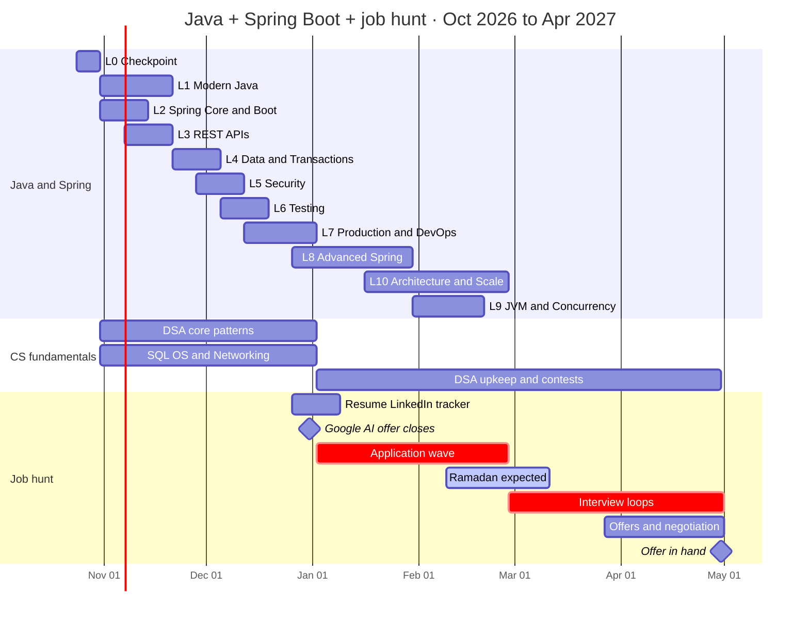
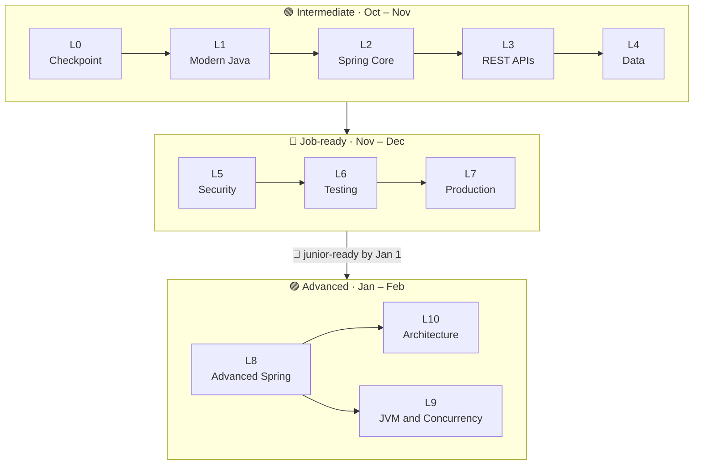
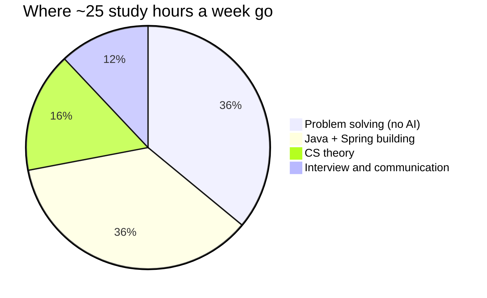
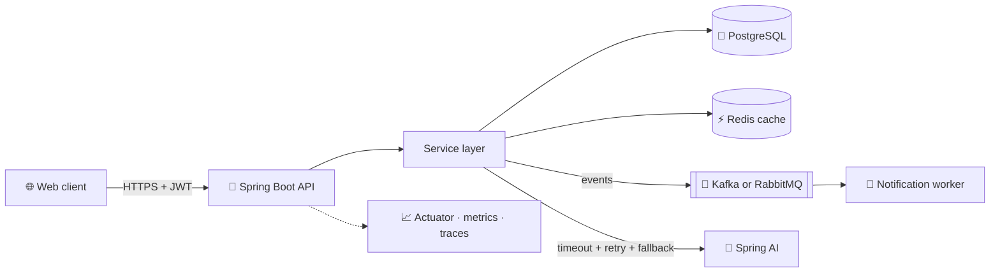
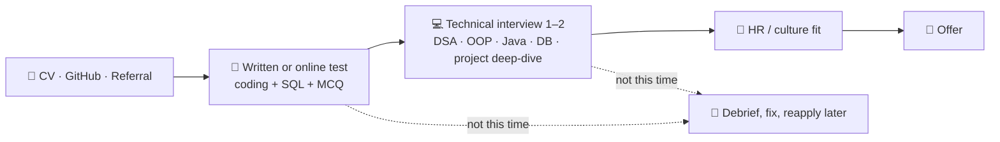

<div align="center">


<h1>☕ Java + Spring Boot Job Guideline</h1>


<br/>


**[🧭 Start](#-start-here)** · **[💡 Philosophy](#-philosophy)** · **[📅 Big Picture](#-the-big-picture)** · **[☕ Java + Spring Roadmap](#-the-java-and-spring-boot-roadmap)** · **[🧠 CS Track](#-cs-fundamentals-track)** · **[🚀 Week by Week](#-week-by-week-plan)**
<br/>
**[🔁 Daily System](#-daily-system)** · **[🤖 AI Rules](#-ai-rules-of-engagement)** · **[💼 Projects](#-portfolio-projects)** · **[🎯 Companies](#-target-companies)** · **[📝 Hiring in BD](#-how-hiring-works-in-bangladesh)** · **[🎤 Questions](#-interview-question-bank)**
<br/>
**[📄 Resume](#-resume-linkedin-and-referrals)** · **[📊 Scoreboard](#-scoreboard)** · **[📚 Resources](#-resources)** · **[🆘 Plan B](#-plan-b)**

<sub>Versions, offers and dates last verified on <b>October 23, 2026</b>.</sub>

</div>

---

## 🧭 Start Here

> [!TIP]
> **How to use this guide**
> - Click any **▶** row to expand it.
> - Tick boxes by editing this file (`- [ ]` → `- [x]`) and committing. Your progress becomes a public streak.
> - Want click-to-tick? Paste a week's checklist into a **GitHub Issue**. Task lists in issues are clickable.
> - Every Friday: update the [📊 Scoreboard](#-scoreboard) and the progress bars, then commit (`week 3 ✅`).

**The loop for every level of the roadmap**

| 1 · Learn | 2 · Build | 3 · Prove | 4 · Teach |
|:-:|:-:|:-:|:-:|
| Official docs first, then one good tutorial | Add it to Kaaj or FloodLens | Pass the exit test with no notes and no AI | Write a one-page note in `notes/` in your own words |

<details>
<summary><b>📁 Suggested repo structure</b></summary>

```text
JavaSpringBoot_Job_guideline/
├── README.md     ← this guide
├── notes/        ← your own explanations, one file per topic: L4-transactions.md, os-deadlock.md
├── dsa/          ← one file per problem, pattern in the name: sliding-window_longest-substring.java
└── debriefs/     ← one file per test or interview (template in Phase 4)
```

</details>

---

## 💡 Philosophy

> **AI makes you fast. Fundamentals make you trustworthy. You need both.**
>
> <sub>Inspired by a LinkedIn post from Kawsar Ahmed (Head of Engineering) on how CSE students should prepare in the AI era.</sub>

| # | Principle | How this guide applies it |
|:-:|---|---|
| 1 | Train CS fundamentals every day | Daily problem solving + one rotating theory topic (DB → OS → Networks → Java → Design) |
| 2 | Use your student perks | Week 0: GitHub Student Developer Pack, JetBrains Student Pack, Google's student AI offer |
| 3 | Use AI tools, but understand what they write | [AI Rules](#-ai-rules-of-engagement): nothing ships that you can't explain line by line |
| 4 | Build, deploy and debug real projects | Every roadmap level adds a real feature to Kaaj or FloodLens |
| 5 | Solve problems without AI | All DSA practice, exit tests and mock tests are AI-free, with paper practice weekly |

**Four additions for the Bangladesh market**

| # | Addition | Why it matters here |
|:-:|---|---|
| 6 | 📝 **Train for the written test** | Many BD companies screen with a timed written or online test (coding + SQL + MCQ) before anyone looks at your projects |
| 7 | 🤝 **Build referrals early** | Some companies prioritise referred candidates. A referral skips the CV pile |
| 8 | ☕ **One stack, deep** | Java + Spring Boot + PostgreSQL. Depth in one stack beats a tour of five |
| 9 | 🎤 **Talk like an engineer** | Many top BD employers serve clients in Europe, the US and Japan. Explaining your own code clearly in English is part of the job |

---

## 📅 The Big Picture



| Track | Progress <sub>(swap ⬜ for 🟩)</sub> |
|---|---|
| ☕ **Roadmap levels L0 – L10** | ⬜⬜⬜⬜⬜⬜⬜⬜⬜⬜⬜ `0/11` |
| 🟦 **Phase 0 · Launch** · Oct 24 – 30 | ⬜ `0/1` |
| 🟩 **Phase 1 · Foundations** · Oct 31 – Dec 4 | ⬜⬜⬜⬜⬜ `0/5` |
| 🟨 **Phase 2 · Build and Ship** · Dec 5 – Jan 1 | ⬜⬜⬜⬜ `0/4` |
| 🟧 **Phase 3 · Apply and Interview** · Jan 2 – Feb 26 | ⬜⬜⬜⬜⬜⬜⬜⬜ `0/8` |
| 🟥 **Phase 4 · Close** · Feb 27 – Apr 30 | ⬜⬜⬜⬜⬜⬜⬜⬜⬜ `0/9` |

---

## ☕ The Java and Spring Boot Roadmap

You already know the beginner basics, so this roadmap starts with a quick **checkpoint (L0)** and then climbs from intermediate to advanced.

> [!IMPORTANT]
> **Use current versions** (checked Oct 23, 2026)
> - **Java 21 or 25**, both LTS. Many job posts still say Java 17 or 21; everything you learn carries over.
> - **Spring Boot 4.1.x** (4.1.0 shipped in June 2026) on Spring Framework 7. Spring Boot 3.5 lost open-source support on June 30, 2026, so build new work on 4.x, but expect many companies to still run 3.x.
> - **Outdated-tutorial red flags:** `javax.*` imports, `WebSecurityConfigurerAdapter`, `RestTemplate` in new code, Spring Boot 2.x. Translate them to the modern API or find a newer source.



| Level | Focus | When | Stage | Done |
|:-:|---|---|:-:|:-:|
| [**L0**](#level-0) | Checkpoint: confirm the basics | W0 · Oct 24 – 30 | 🟢 | ⬜ |
| [**L1**](#level-1) | Modern Java | W1–3 · Oct 31 – Nov 20 | 🟢 | ⬜ |
| [**L2**](#level-2) | Spring Core and Boot internals | W1–2 · Oct 31 – Nov 13 | 🟢 | ⬜ |
| [**L3**](#level-3) | REST APIs done right | W2–3 · Nov 7 – 20 | 🟢 | ⬜ |
| [**L4**](#level-4) | Data and transactions | W4–5 · Nov 21 – Dec 4 | 🟢 | ⬜ |
| [**L5**](#level-5) | Security | W5–6 · Nov 28 – Dec 11 | 🔵 | ⬜ |
| [**L6**](#level-6) | Testing | W6–7 · Dec 5 – 18 | 🔵 | ⬜ |
| [**L7**](#level-7) | Production and DevOps | W7–9 · Dec 12 – Jan 1 | 🔵 | ⬜ |
| [**L8**](#level-8) | Advanced Spring and backend patterns | W9–13 · Dec 26 – Jan 29 | 🟣 | ⬜ |
| [**L9**](#level-9) | Concurrency, JVM and performance | W14–16 · Jan 30 – Feb 19 | 🟣 | ⬜ |
| [**L10**](#level-10) | Architecture and scale | W12–17 · Jan 16 – Feb 26 | 🟣 | ⬜ |

<a id="level-0"></a>
<details open>
<summary><b>🟢 L0 · Checkpoint</b> · you are here · prove the basics in one sitting</summary>

**🎯 Goal:** confirm your beginner knowledge is solid, so nothing wobbles later. Do it in one 2-hour sitting, without tutorials or AI.

**✅ Self-test**
- [ ] Write a Java program with a class hierarchy, an interface, an `ArrayList`, a `HashMap` and a custom exception
- [ ] Explain `static`, `final`, access modifiers, overloading vs overriding, and `==` vs `equals()`
- [ ] Use Maven or Gradle: add a dependency, run tests, build a runnable jar
- [ ] Generate a Spring Boot app at [start.spring.io](https://start.spring.io) with one entity, CRUD endpoints and PostgreSQL
- [ ] Call every endpoint with Postman, HTTPie or `curl`
- [ ] Use Git: branch, commit, merge, push and open a pull request

> Any box you can't tick → spend 2–3 days on it with [dev.java](https://dev.java/learn/) and [Spring guides](https://spring.io/guides) before L1.

</details>

<a id="level-1"></a>
<details>
<summary><b>🟢 L1 · Modern Java</b> · W1–3 · write idiomatic Java 21+ and explain what happens underneath</summary>

**🎯 Goal:** write clean, modern Java and explain the internals interviewers ask about.

**📚 Learn**
- [ ] OOP done right: composition over inheritance, interfaces vs abstract classes, SOLID
- [ ] Collections: choosing `List` / `Set` / `Map` / `Deque`, `HashMap` internals, `equals` / `hashCode`, `Comparable` vs `Comparator`, sequenced collections (Java 21)
- [ ] Generics: bounded types, wildcards, PECS (*producer extends, consumer super*), type erasure
- [ ] Functional Java: lambdas, method references, `Stream` pipelines, collectors (`groupingBy`, `partitioningBy`, `toMap`), `Optional` used properly
- [ ] Modern syntax: `var`, records, sealed interfaces, pattern matching for `instanceof` and `switch`, record patterns, text blocks
- [ ] Exceptions: checked vs unchecked, custom exceptions, try-with-resources, never swallow an exception
- [ ] Immutability, the `String` pool, `StringBuilder`, `java.time` (never `java.util.Date`)
- [ ] Java 25 awareness: flexible constructor bodies, module import declarations, compact source files, scoped values

**🛠️ Build**
- [ ] Use records for Kaaj DTOs and a sealed interface for a result or status type
- [ ] A small "job filter" with streams: group jobs by district, top 5 by wage, partition remote vs on-site

**✅ Prove it**
- [ ] Explain `HashMap.put()` step by step, including collisions, resizing and treeification
- [ ] Rewrite a 20-line loop as a stream pipeline, then explain when the loop is the better choice
- [ ] Explain why `List<Object>` is not a supertype of `List<String>`

**🔗 Read:** [dev.java/learn](https://dev.java/learn/) · [roadmap.sh/java](https://roadmap.sh/java) · [Baeldung](https://www.baeldung.com) · *Effective Java* (book)

</details>

<a id="level-2"></a>
<details>
<summary><b>🟢 L2 · Spring Core and Boot internals</b> · W1–2 · know what Boot does for you, so you can debug it</summary>

**🎯 Goal:** understand the container, configuration and auto-configuration well enough to fix things when "magic" breaks.

**📚 Learn**
- [ ] IoC container, `ApplicationContext`, beans, constructor injection (and why not field injection)
- [ ] `@Component` vs `@Bean` in `@Configuration`, component scanning, `@Primary` vs `@Qualifier`
- [ ] Bean scopes and lifecycle (`@PostConstruct`, `@PreDestroy`), why circular dependencies are a design smell
- [ ] Configuration: `application.yml`, profiles, type-safe `@ConfigurationProperties`, environment variables for secrets
- [ ] Auto-configuration: starters, `@Conditional…` annotations, reading the condition report (`--debug`)
- [ ] AOP and proxies (JDK dynamic vs CGLIB): why `@Transactional`, `@Async` and `@Cacheable` only work through the proxy
- [ ] Logging with SLF4J + Logback, log levels per package
- [ ] Spring Boot 4 changes: modular starters (e.g. `spring-boot-starter-webmvc`), Jackson 3 (`tools.jackson` packages, `JsonMapper`), `jakarta.*`, JSpecify null-safety

**🛠️ Build**
- [ ] Move all Kaaj config into typed `@ConfigurationProperties` classes with `dev` and `prod` profiles
- [ ] A conditional bean: a fake AI client in `dev`, the real one in `prod`

**✅ Prove it**
- [ ] Explain what `@SpringBootApplication` expands to and how Boot decides to create a `DataSource`
- [ ] Explain why calling a `@Transactional` method from the same class doesn't start a transaction

**🔗 Read:** [Spring Boot reference](https://docs.spring.io/spring-boot/) · [Spring Framework reference](https://docs.spring.io/spring-framework/reference/) · [Spring Academy](https://spring.academy)

</details>

<a id="level-3"></a>
<details>
<summary><b>🟢 L3 · REST APIs done right</b> · W2–3 · design APIs a senior would approve</summary>

**🎯 Goal:** build clean, predictable, documented APIs.

**📚 Learn**
- [ ] Spring MVC request flow: `DispatcherServlet` → handler mapping → controller → message converters
- [ ] REST design: resources, methods, status codes, idempotency, pagination, sorting, filtering
- [ ] DTOs vs entities (never expose entities), mapping by hand or with MapStruct
- [ ] Bean Validation (`@Valid`, custom validators) and global errors with `@RestControllerAdvice` + `ProblemDetail` (RFC 9457)
- [ ] API versioning (built into Spring Framework 7) and OpenAPI docs with springdoc-openapi
- [ ] Calling other APIs with `RestClient` and HTTP interface clients (`@HttpExchange`). `RestTemplate` is on its way out
- [ ] File upload and download (multipart), CORS

**🛠️ Build**
- [ ] Kaaj jobs API: `GET /api/v1/jobs?district=&skill=&page=&size=&sort=` with validation and `ProblemDetail` errors
- [ ] Swagger UI live, every endpoint documented with an example

**✅ Prove it**
- [ ] Explain PUT vs PATCH, 401 vs 403, and 400 vs 409 vs 422
- [ ] Design the "apply to a job" endpoints, including what happens on a duplicate application

**🔗 Read:** [Spring Framework reference (Web MVC)](https://docs.spring.io/spring-framework/reference/) · [springdoc-openapi](https://springdoc.org) · [Zalando REST guidelines](https://opensource.zalando.com/restful-api-guidelines/)

</details>

<a id="level-4"></a>
<details>
<summary><b>🟢 L4 · Data and transactions</b> · W4–5 · never be surprised by the SQL Hibernate sends</summary>

**🎯 Goal:** model data well, keep queries fast and transactions correct.

**📚 Learn**
- [ ] SQL first: joins, aggregates, window functions, indexes, `EXPLAIN ANALYZE` in PostgreSQL
- [ ] JDBC basics, then `JdbcClient` for simple queries
- [ ] JPA / Hibernate: entity lifecycle, persistence context, dirty checking, flushing
- [ ] Relationships: owning side, `mappedBy`, cascades, orphan removal, `LAZY` by default
- [ ] The N+1 problem: detect it (SQL logging) and fix it (fetch join, `@EntityGraph`, batch size, DTO projections)
- [ ] Spring Data JPA: derived queries, `@Query`, projections, Specifications, `Pageable`
- [ ] `@Transactional`: propagation, isolation, `readOnly`, rollback rules
- [ ] Concurrency: optimistic locking with `@Version`, pessimistic locks
- [ ] Flyway migrations; turn off Open Session In View (`spring.jpa.open-in-view=false`); HikariCP pool basics

**🛠️ Build**
- [ ] Kaaj: Flyway migrations for the full schema plus seed data
- [ ] Find and fix one N+1 query; put the before/after query count in the PR
- [ ] Add `@Version` to job applications so the same one can't be processed twice

**✅ Prove it**
- [ ] Explain what happens when you change a managed entity's field and the transaction commits, without calling `save()`
- [ ] Explain READ COMMITTED vs REPEATABLE READ with a concrete example

**🔗 Read:** [Spring Data JPA reference](https://docs.spring.io/spring-data/jpa/reference/) · [Vlad Mihalcea's blog](https://vladmihalcea.com) · [Use The Index, Luke](https://use-the-index-luke.com)

</details>

<a id="level-5"></a>
<details>
<summary><b>🔵 L5 · Security</b> · W5–6 · secure APIs and explain every step of the filter chain</summary>

**🎯 Goal:** authentication and authorization you can defend in an interview.

**📚 Learn**
- [ ] Spring Security architecture: `SecurityFilterChain`, filters, `AuthenticationManager`, `UserDetailsService`, `PasswordEncoder` (BCrypt)
- [ ] Authentication vs authorization, roles vs authorities, method security with `@PreAuthorize`
- [ ] Stateless JWT: issue, validate, expire, refresh; Spring's OAuth2 Resource Server JWT support
- [ ] CORS vs CSRF: when CSRF protection matters (cookie sessions) and when it doesn't (bearer tokens)
- [ ] OWASP Top 10 basics: injection, broken access control, secrets in Git, brute-force protection on login
- [ ] Modern configuration only: lambda DSL, no `WebSecurityConfigurerAdapter`

**🛠️ Build**
- [ ] Kaaj: register and login, JWT access + refresh tokens, roles `JOB_SEEKER` / `EMPLOYER` / `ADMIN`
- [ ] Ownership checks: an employer can only edit their own job posts, with a test that proves it

**✅ Prove it**
- [ ] Draw the path of a JWT request from the HTTP request through the filter chain to the controller
- [ ] Explain where a browser should keep tokens and the trade-offs of each option

**🔗 Read:** [Spring Security reference](https://docs.spring.io/spring-security/reference/) · [OWASP Top 10](https://owasp.org/www-project-top-ten/)

</details>

<a id="level-6"></a>
<details>
<summary><b>🔵 L6 · Testing</b> · W6–7 · tests that let you refactor without fear</summary>

**🎯 Goal:** a test suite that catches real bugs and runs on every pull request.

**📚 Learn**
- [ ] JUnit 5 + AssertJ, parameterized tests
- [ ] Mockito: mocks vs stubs vs spies, and why you shouldn't mock what you don't own
- [ ] Slice tests: `@WebMvcTest` with MockMvc or `RestTestClient` (Spring Framework 7), `@DataJpaTest`
- [ ] `@SpringBootTest` integration tests on real PostgreSQL with Testcontainers and `@ServiceConnection`
- [ ] Testing secured endpoints (`@WithMockUser`, JWT tests)
- [ ] Test pyramid and coverage with JaCoCo (meaningful, not 100%)

**🛠️ Build**
- [ ] Kaaj: service unit tests, controller slice tests and one integration test per main flow
- [ ] All tests run in CI on every pull request

**✅ Prove it**
- [ ] Explain why a passing H2 test doesn't prove your PostgreSQL query works
- [ ] Once a week, write a failing test for a bug before you fix it

**🔗 Read:** [Spring Boot testing docs](https://docs.spring.io/spring-boot/reference/testing/index.html) · [Testcontainers guides](https://testcontainers.com/guides/)

</details>

<a id="level-7"></a>
<details>
<summary><b>🔵 L7 · Production and DevOps</b> · W7–9 · build it, ship it, watch it run</summary>

**🎯 Goal:** run your app like a real service. After L7 you are **junior-ready**.

**📚 Learn**
- [ ] Docker: multi-stage Dockerfile or Buildpacks (`./mvnw spring-boot:build-image`), Spring Boot's Docker Compose support for local dev
- [ ] CI/CD with GitHub Actions: build, test, build image, deploy
- [ ] Externalised config and secrets (env vars), 12-factor basics
- [ ] Actuator: health, liveness and readiness, metrics, info
- [ ] Observability: Micrometer metrics, tracing with OpenTelemetry, structured JSON logs, a request ID on every log line
- [ ] Graceful shutdown, a reverse proxy (Nginx basics), HTTPS
- [ ] Linux for servers: processes, ports, logs, `systemd`

**🛠️ Build**
- [ ] Kaaj deployed with a live URL and a CI badge in its README
- [ ] Structured logs with a request ID you can follow end to end

**✅ Prove it**
- [ ] Explain your pipeline from `git push` to a running container
- [ ] Debug a crash using only logs and Actuator

**🔗 Read:** [Spring Boot Actuator docs](https://docs.spring.io/spring-boot/reference/actuator/index.html) · [Docker docs](https://docs.docker.com) · [GitHub Actions docs](https://docs.github.com/actions)

</details>

<a id="level-8"></a>
<details>
<summary><b>🟣 L8 · Advanced Spring and backend patterns</b> · W9–13 · the features that make a project look senior</summary>

**🎯 Goal:** handle load, failures and async work the way production teams do.

**📚 Learn**
- [ ] Caching: Spring Cache abstraction + Redis, TTLs, eviction, cache-aside, cache stampede
- [ ] Async and scheduling: `@Async`, `@Scheduled`, virtual threads (`spring.threads.virtual.enabled=true`)
- [ ] Messaging with Kafka or RabbitMQ: producers, consumers, retries, dead-letter topics
- [ ] Reliability: idempotency keys, the outbox pattern, at-least-once delivery
- [ ] Resilience: timeouts, retries with backoff (Spring Framework 7 `@Retryable`), `@ConcurrencyLimit`, circuit breakers with Resilience4j
- [ ] Rate limiting (Bucket4j or a Redis token bucket)
- [ ] Domain events with `ApplicationEventPublisher` and `@TransactionalEventListener`
- [ ] Real-time updates with WebSocket or Server-Sent Events
- [ ] AI integration with Spring AI 2.x: `ChatClient`, structured output, embeddings and vector search with pgvector

**🛠️ Build**
- [ ] Kaaj: cache job search in Redis and measure p95 latency before and after
- [ ] Kaaj: "new matching job" notifications through an event and an async consumer
- [ ] Kaaj: wrap the AI call in a timeout, retry and fallback; use Spring AI with a free model (Ollama locally or a free-tier API)
- [ ] FloodLens: async verification pipeline + per-user rate limiting ([details](#-portfolio-projects))

**✅ Prove it**
- [ ] Explain how you invalidate the cache when an employer edits a job post
- [ ] Explain how you avoid sending a notification twice if the consumer crashes mid-way

**🔗 Read:** [Spring resilience features](https://docs.spring.io/spring-framework/reference/core/resilience.html) · [Spring for Apache Kafka](https://docs.spring.io/spring-kafka/reference/) · [Spring AI reference](https://docs.spring.io/spring-ai/reference/) · [Resilience4j](https://resilience4j.readme.io)

</details>

<a id="level-9"></a>
<details>
<summary><b>🟣 L9 · Concurrency, JVM and performance</b> · W14–16 · answer the deep questions and fix slow code with evidence</summary>

**🎯 Goal:** reason about threads and memory, and speed things up with measurements, not guesses.

**📚 Learn**
- [ ] Java Memory Model: visibility, happens-before, `volatile`, `synchronized`
- [ ] `java.util.concurrent`: `ExecutorService`, `CompletableFuture`, `ConcurrentHashMap`, atomics, locks, `CountDownLatch`
- [ ] Virtual threads: how they work, when they help (I/O-bound) and when they don't (CPU-bound); pinning, and how [JEP 491](https://openjdk.org/jeps/491) removed it for `synchronized` in JDK 24
- [ ] Deadlocks, race conditions, thread-safety of singleton Spring beans
- [ ] JVM memory: heap, stack, metaspace; garbage collection basics (G1, ZGC)
- [ ] Profiling: JDK Flight Recorder + JDK Mission Control, VisualVM, thread dumps, heap dumps
- [ ] Load testing with [k6](https://k6.io) or Gatling; latency percentiles (p50, p95, p99)
- [ ] Database performance: index design, query plans, connection pool sizing

**🛠️ Build**
- [ ] Load-test Kaaj's search endpoint, profile it with JFR, fix the top bottleneck and write it up in the README
- [ ] Reproduce a race condition in a small demo, then fix it three ways

**✅ Prove it**
- [ ] Explain why `count++` isn't thread-safe and three ways to fix it
- [ ] Explain when virtual threads won't make your app faster

**🔗 Read:** [dev.java](https://dev.java/learn/) (concurrency and virtual threads) · *Java Concurrency in Practice* (book)

</details>

<a id="level-10"></a>
<details>
<summary><b>🟣 L10 · Architecture and scale</b> · W12–17 · talk system design with confidence</summary>

**🎯 Goal:** junior-to-mid level design skills: boundaries, trade-offs and scaling.

**📚 Learn**
- [ ] Layered vs hexagonal (ports and adapters) architecture; modular monoliths with Spring Modulith
- [ ] Monolith vs microservices: when *not* to split; drawing service boundaries
- [ ] Microservice basics: API gateway (Spring Cloud Gateway), service discovery, distributed tracing
- [ ] Data across services: sagas, eventual consistency, CQRS (concept), idempotent consumers
- [ ] Scaling: stateless services, horizontal scaling, load balancing, read replicas, partitioning, CDNs
- [ ] Caching strategies and consistency trade-offs (CAP in practice)
- [ ] HLD practice: URL shortener, rate limiter, notification system, job-board search
- [ ] LLD practice in Java: parking lot, library management, ride booking, elevator

**🛠️ Build**
- [ ] Turn Kaaj into a modular monolith with Spring Modulith and verify module boundaries in a test
- [ ] Write an ADR (architecture decision record) in Kaaj's repo for one big decision

**✅ Prove it**
- [ ] 30-minute mock: "Design Kaaj for 1 million job seekers"
- [ ] Defend one trade-off you made, with numbers

**🔗 Read:** [System Design Primer](https://github.com/donnemartin/system-design-primer) · [Spring Modulith reference](https://docs.spring.io/spring-modulith/reference/) · *Designing Data-Intensive Applications* (book)

</details>

<details>
<summary><b>✨ Optional stretch topics</b> · awareness only, after L10</summary>

- [ ] Reactive programming with Spring WebFlux (and when it's worth the complexity)
- [ ] GraalVM native images
- [ ] Kubernetes basics: pods, deployments, services, probes
- [ ] gRPC with Spring (Spring Boot 4.1 added Spring gRPC support)
- [ ] Kotlin for Spring developers

</details>

---

## 🧠 CS Fundamentals Track

BD written tests and interviews check fundamentals hard, so this track runs alongside the Java roadmap.

**DSA pattern tracker** <sub>(no AI · update the Solved and Confidence columns as you go)</sub>

| Pattern | Week | Target | Solved | Confidence |
|---|:-:|:-:|:-:|:-:|
| Arrays and Hashing | W1 | 6 | 0 | 🔴 |
| Two Pointers | W1 | 6 | 0 | 🔴 |
| Sliding Window | W2 | 6 | 0 | 🔴 |
| Stack / Monotonic Stack | W2 | 6 | 0 | 🔴 |
| Binary Search | W3 | 6 | 0 | 🔴 |
| Linked List | W3 | 6 | 0 | 🔴 |
| Trees (DFS / BFS / BST) | W4 | 8 | 0 | 🔴 |
| Heap / Priority Queue | W4 | 4 | 0 | 🔴 |
| Graphs (BFS / DFS / Topo / Union-Find) | W5 | 12 | 0 | 🔴 |
| Backtracking | W6 | 5 | 0 | 🔴 |
| Dynamic Programming | W6–7 | 15 | 0 | 🔴 |
| Greedy and Intervals | W8 | 10 | 0 | 🔴 |
| Tries | W9 | 3 | 0 | 🔴 |
| Weak-pattern revision | W9 | 7 | 0 | 🔴 |
| **Total by Jan 1** | | **100** | **0** | |

<sub>Confidence: 🔴 shaky · 🟡 okay · 🟢 interview-ready</sub>

<details>
<summary><b>🗄️ Databases and SQL</b></summary>

- [ ] JOINs (inner, left, self), `GROUP BY` / `HAVING`, subqueries, CTEs
- [ ] Window functions: `ROW_NUMBER`, `RANK`, running totals
- [ ] Normalisation 1NF → BCNF
- [ ] Indexes: B-tree, composite index order, when indexes hurt, `EXPLAIN ANALYZE`
- [ ] Transactions: ACID, isolation levels and their anomalies
- [ ] Locking: optimistic vs pessimistic
- [ ] SQL vs NoSQL: when Redis or a document store fits

</details>

<details>
<summary><b>⚙️ Operating Systems</b></summary>

- [ ] Process vs thread, context switch
- [ ] CPU scheduling (FCFS, SJF, Round Robin)
- [ ] Deadlock: 4 conditions, prevention vs avoidance
- [ ] Mutex vs semaphore, race conditions
- [ ] Virtual memory, paging, page faults, thrashing
- [ ] User mode vs kernel mode, system calls

</details>

<details>
<summary><b>🌐 Networking</b></summary>

- [ ] OSI vs TCP/IP layers
- [ ] TCP vs UDP, 3-way handshake
- [ ] HTTP methods, idempotency, status codes
- [ ] HTTPS / TLS at a high level, DNS resolution
- [ ] "What happens when you type a URL"
- [ ] REST vs gRPC vs GraphQL, WebSockets, CORS
- [ ] Cookies vs sessions vs JWT

</details>

<details>
<summary><b>🐧 Linux, Git and engineering practice</b></summary>

- [ ] 20 everyday commands: `grep`, `find`, `chmod`, `ps`, `top`, `curl`, `tail -f`, pipes and redirects
- [ ] Git: branching, rebase vs merge, resolving conflicts, `git bisect`
- [ ] Design patterns: Singleton, Factory, Builder, Strategy, Observer
- [ ] Agile / Scrum basics, writing a good pull request

</details>

---

## 🚀 Week-by-Week Plan

> Problem counts are minimums. Exam week? Switch to 🛡️ maintenance mode and pick up where you left off.

### 🟦 Phase 0 · Launch

<details open>
<summary><b>Week 0 · Oct 24 – 30</b> · set up and check your level</summary>

- [ ] Star and pin this repo; tick boxes every week
- [ ] Apply for the [GitHub Student Developer Pack](https://education.github.com/pack) and the free [JetBrains Student Pack](https://www.jetbrains.com/academy/student-pack/) (IntelliJ IDEA Ultimate is the big win for Spring)
- [ ] Claim Google's student AI offer at [one.google.com/ai-student](https://one.google.com/ai-student) (Bangladesh is not on the exclusion list). **Redeem by Dec 31, 2026.** It needs a payment method and becomes paid ($4.99/month or the local equivalent) after the free year unless you cancel, so set a reminder
- [ ] Install JDK 21 or 25, IntelliJ IDEA, Docker, PostgreSQL (or run it in Docker), and Postman or HTTPie
- [ ] Create or clean up accounts: LeetCode, Codeforces, HackerRank
- [ ] ☕ Complete the [L0 checkpoint](#level-0)
- [ ] 🧠 Baseline test (90 min, no AI): 2 easy + 1 medium problem and 5 SQL queries. Write down every topic that hurt
- [ ] Mark midterm and final weeks in your calendar; list 20 seniors or alumni at your [target companies](#-target-companies)

> [!NOTE]
> GitHub paused new **Copilot Student** sign-ups in April 2026 and hasn't given an end date. The rest of the Student Pack still works; check the pack page for what's live when you apply.

</details>

### 🟩 Phase 1 · Foundations

<details>
<summary><b>Week 1 · Oct 31 – Nov 6</b> · Java depth and the Spring container</summary>

- [ ] ☕ L1: OOP + SOLID, collections and `HashMap` internals
- [ ] ☕ L2: IoC, beans, constructor injection, `@ConfigurationProperties`, profiles
- [ ] 🧠 Arrays and Hashing + Two Pointers · 12 problems
- [ ] 🗄️ SQL: JOINs, `GROUP BY` / `HAVING` · 15 queries
- [ ] 🛠️ Kaaj: agree who owns what; take a clear backend slice (for example auth + jobs API); set up branches, PR template and an issue board

</details>

<details>
<summary><b>Week 2 · Nov 7 – 13</b> · Spring internals and REST basics</summary>

- [ ] ☕ L1: generics (PECS), lambdas, streams, collectors, `Optional`
- [ ] ☕ L2: auto-configuration, `@Conditional`, proxies and AOP
- [ ] ☕ L3: `DispatcherServlet` flow, DTOs, Bean Validation
- [ ] 🧠 Sliding Window + Stack · 12 problems
- [ ] 🗄️ Subqueries, CTEs, window functions
- [ ] 🏆 First Codeforces contest (Div. 3 or 4). Showing up is the goal

</details>

<details>
<summary><b>Week 3 · Nov 14 – 20</b> · modern Java and clean APIs</summary>

- [ ] ☕ L1: records, sealed types, pattern matching, exceptions, `java.time`
- [ ] ☕ L3: `ProblemDetail` errors, pagination and sorting, API versioning, OpenAPI, `RestClient`
- [ ] 🧠 Binary Search + Linked List · 12 problems
- [ ] 🗄️ Normalisation and indexing
- [ ] 🛠️ Kaaj: versioned jobs API with validation, `ProblemDetail` errors and Swagger UI
- [ ] 📝 Paper practice: solve 2 problems by hand, then type and test them

</details>

<details>
<summary><b>Week 4 · Nov 21 – 27</b> · the data layer</summary>

- [ ] ☕ L4: entity lifecycle, persistence context, relationships, N+1 fixes, Spring Data queries and projections
- [ ] 🧠 Trees + Heap · 12 problems
- [ ] 🗄️ ACID, isolation levels, locking
- [ ] 🛠️ Kaaj: Flyway migrations; fix one N+1 query (log the SQL count before and after)
- [ ] 🎤 Explain the persistence context aloud in 3 minutes and record it

</details>

<details>
<summary><b>Week 5 · Nov 28 – Dec 4</b> · transactions, security basics and mock test #1</summary>

- [ ] ☕ L4: `@Transactional` propagation, isolation and rollback rules, `@Version`, Open Session In View off
- [ ] ☕ L5: Spring Security architecture, BCrypt, `SecurityFilterChain`
- [ ] 🧠 Graphs: BFS / DFS, topological sort, Union-Find · 12 problems
- [ ] ⚙️ OS: process vs thread, scheduling, deadlock
- [ ] 📝 **Mock written test #1** (90 min, no AI): 3 coding problems + 10 SQL / OOP MCQs + 5 Java output-tracing questions
- [ ] ✅ Phase review: update the [Scoreboard](#-scoreboard); list your 3 weakest topics for extra time in Phase 2

</details>

### 🟨 Phase 2 · Build and Ship

<details>
<summary><b>Week 6 · Dec 5 – 11</b> · secure it and start testing</summary>

- [ ] ☕ L5: JWT access + refresh tokens, `@PreAuthorize`, CORS vs CSRF
- [ ] ☕ L6: JUnit 5, AssertJ, Mockito, `@WebMvcTest`
- [ ] 🧠 Backtracking + intro to 1-D DP · 10 problems
- [ ] ⚙️ OS: memory, paging, mutex vs semaphore
- [ ] 🛠️ Kaaj: roles `JOB_SEEKER` / `EMPLOYER` / `ADMIN` and ownership checks, with tests

</details>

<details>
<summary><b>Week 7 · Dec 12 – 18</b> · real tests, real containers</summary>

- [ ] ☕ L6: `@DataJpaTest`, Testcontainers + `@ServiceConnection`, security tests
- [ ] ☕ L7: multi-stage Dockerfile, Docker Compose (API + PostgreSQL + Redis)
- [ ] 🧠 1-D and 2-D DP · 10 problems
- [ ] 🌐 TCP vs UDP, HTTP, DNS, "what happens when you type a URL"
- [ ] 🐧 Linux: 20 everyday commands

</details>

<details>
<summary><b>Week 8 · Dec 19 – 25</b> · ship it to the internet</summary>

- [ ] ☕ L7: GitHub Actions CI, deploy, Actuator, structured logs
- [ ] 🧠 Greedy + Intervals · 10 problems
- [ ] 🌐 HTTPS / TLS, REST design, CORS, WebSockets
- [ ] 🛠️ Kaaj: **live URL** and CI badge in its README
- [ ] 🛠️ FloodLens MVP begins: report API + PostGIS "reports near me" query
- [ ] ⏰ Claim Google's student offer before Dec 31

</details>

<details>
<summary><b>Week 9 · Dec 26 – Jan 1</b> · the junior-ready checkpoint</summary>

- [ ] ☕ L7: metrics and tracing basics
- [ ] ☕ L8 begins: Spring Cache + Redis
- [ ] 🧠 Tries + your 3 weakest patterns · 10 problems
- [ ] 🏛️ System design basics: caching, load balancing, message queues
- [ ] 🛠️ FloodLens: async verification + Redis rate limiting + deploy
- [ ] 📄 Resume v1 and LinkedIn overhaul ([guide](#-resume-linkedin-and-referrals)); company tracker filled
- [ ] 🎯 **Junior-ready check:** every L0–L7 "Prove it" box ticked?

</details>

### 🟧 Phase 3 · Apply and Interview

> [!NOTE]
> **Plan around Ramadan and Eid.** In Bangladesh, Ramadan 2027 is expected to begin around **Feb 9** and Eid-ul-Fitr around **Mar 10 or 11**, depending on the moon sighting. Hiring often slows around the Eid holidays, so front-load applications in January and early February, and use the slower weeks for deep prep and mocks.

<details>
<summary><b>Week 10 · Jan 2 – 8</b> · launch week</summary>

- [ ] 📄 Resume reviewed by 3 people, at least one a working engineer
- [ ] 🎯 First 8 applications + 5 referral messages
- [ ] ☕ L8: `@Async`, `@Scheduled`, virtual threads, domain events
- [ ] 🧠 2 mixed problems a day + a weekend contest
- [ ] 🎤 Write 5 STAR stories: a group-project conflict, a hard bug, a deadline, a failure, a time you led

</details>

<details>
<summary><b>Week 11 · Jan 9 – 15</b> · messaging and reliability</summary>

- [ ] ☕ L8: Kafka or RabbitMQ basics, idempotency keys, the outbox pattern
- [ ] 🏛️ LLD in Java: parking lot, library management (class diagram + code)
- [ ] 🎯 6–8 applications
- [ ] 🎤 Mock interview #1 (45 min: 1 DSA problem + project deep-dive)

</details>

<details>
<summary><b>Week 12 · Jan 16 – 22</b> · resilience and design</summary>

- [ ] ☕ L8: timeouts, `@Retryable`, circuit breakers, rate limiting
- [ ] ☕ L10: layered vs hexagonal architecture, modular monoliths
- [ ] 🏛️ HLD: URL shortener, rate limiter
- [ ] 🗄️ Finish [LeetCode SQL 50](https://leetcode.com/studyplan/top-sql-50/)
- [ ] 🎯 6–8 applications
- [ ] 📝 Mock written test #2

</details>

<details>
<summary><b>Week 13 · Jan 23 – 29</b> · AI feature and company research</summary>

- [ ] ☕ L8: Spring AI in Kaaj (`ChatClient`, structured output, timeout + fallback)
- [ ] 🔍 Research your top 5 companies: products, stack (from job posts), recent news, latest interview reports
- [ ] 🐧 Git under pressure: rebase vs merge, conflicts, `git bisect`
- [ ] 🎯 6–8 applications
- [ ] 🎤 Mock interview #2

</details>

<details>
<summary><b>Week 14 · Jan 30 – Feb 5</b> · concurrency deep dive</summary>

- [ ] ☕ L9: Java Memory Model, `java.util.concurrent`, `CompletableFuture`, `ConcurrentHashMap`
- [ ] ☕ L10: monolith vs microservices; Spring Modulith boundaries in Kaaj
- [ ] 🎯 6–8 applications (push hard before Ramadan)
- [ ] 📝 Paper practice: 2 problems by hand

</details>

<details>
<summary><b>Week 15 · Feb 6 – 12</b> · JVM and performance</summary>

- [ ] ☕ L9: virtual threads and pinning, GC basics, profiling with JFR
- [ ] 🛠️ Load-test Kaaj's search with k6, fix the top bottleneck, write it up
- [ ] 🤝 10 more referral conversations
- [ ] 🎤 Mock interview #3

</details>

<details>
<summary><b>Week 16 · Feb 13 – 19</b> · tell your project story</summary>

- [ ] ☕ L10: sagas, CQRS (concept), scaling reads, cache consistency
- [ ] 🎤 Rehearse Kaaj in 2-, 5- and 15-minute versions, plus "design Kaaj for 1 million users"
- [ ] 🎯 Applications + follow-ups on pending ones
- [ ] 📝 Mock written test #3

</details>

<details>
<summary><b>Week 17 · Feb 20 – 26</b> · mid-season review</summary>

- [ ] 📊 Funnel review: applications → tests → interviews. Use [Plan B](#-plan-b) to find the leak
- [ ] ☕ Re-take every "Prove it" test you haven't ticked (L0–L10)
- [ ] 🛠️ Kaaj: ADR + one visible improvement
- [ ] 🎤 Mock interview #4

</details>

### 🟥 Phase 4 · Close

<details>
<summary><b>Weeks 18 – 22 · Feb 27 – Apr 2</b> · interview loop mode</summary>

Repeat every week:

- [ ] 🧠 2 problems a day + 1 contest (no AI)
- [ ] 🎤 1 mock or real interview
- [ ] 🎯 5–8 applications + follow-ups
- [ ] 📚 Refresh one section of the [Question Bank](#-interview-question-bank)
- [ ] 📝 Debrief within 24 hours of every test or interview

```markdown
## Debrief: <Company> · <Round> · <Date>
- Format:
- Questions asked:
- What went well:
- Where I got stuck:
- Topics to revise this week:
- Thank-you / follow-up sent? [ ]
```

</details>

<details>
<summary><b>Weeks 23 – 26 · Apr 3 – Apr 30</b> · offers and decisions</summary>

- [ ] Compare offers on mentorship, learning, stack and pay, not pay alone
- [ ] Negotiate politely with data (Glassdoor, levels.fyi, seniors at that company)
- [ ] Get the offer in writing before declining others
- [ ] No offer yet? Go to [Plan B](#-plan-b) and keep the daily system running

</details>

---

## 🔁 Daily System

| Block | Class days (≈3 h) | Weekend (≈5–6 h) |
|---|---|---|
| 🧠 **Problem solving** <sub>no AI</sub> | 75 min · 2 problems | Contest + upsolve 2 problems |
| ☕ **Roadmap level** <sub>AI-assisted build</sub> | 60 min · learn + one small, clean commit | 3 h · ship one feature end to end |
| 📚 **Theory** | 30 min · today's rotation topic | 45 min · review the week's notes |
| 🎤 **Speak it** | 10 min · explain one concept aloud | 1 mock interview (from Week 10) |

**Theory rotation**

| Sun | Mon | Tue | Wed | Thu |
|:-:|:-:|:-:|:-:|:-:|
| 🗄️ Databases and SQL | ⚙️ Operating Systems | 🌐 Networking | ☕ Java and Spring internals | 🏛️ Design (LLD / HLD) |



> [!IMPORTANT]
> **Exam weeks = 🛡️ maintenance mode.** Midterms and finals will hit. In those weeks drop to 1 problem a day + 20 minutes of theory, and don't feel guilty. Consistency beats intensity.

---

## 🤖 AI Rules of Engagement

| Context | AI? | Rule |
|---|:-:|---|
| DSA practice | 🔴 | Struggle 30–45 min first. Then ask AI for a **hint**, never code. Re-solve from scratch 3 days later |
| Exit tests, written tests, mocks | 🔴 | Exam conditions: timer, no autocomplete, paper once a week |
| Project code | 🟢 | Write a "why" in every PR description. If you can't explain a line, rewrite it yourself |
| Learning a level | 🟢 | Use AI as a quizzer: *"Ask me 10 questions on JPA transactions. Don't reveal answers until I reply."* |
| Debugging | 🟡 | Read the stack trace and write your hypothesis first. Then compare with AI |
| Interviews | 🔴 | Never |

> [!NOTE]
> **Weekly AI-free rebuild:** every Saturday, pick one piece of code AI helped you write that week and re-implement it from memory. That's how "I used AI" becomes "I understand this".

---

## 💼 Portfolio Projects

### 1 · Kaaj – The Job <sub>flagship</sub>

> [!NOTE]
> Kaaj is a group project. Interviewers will ask "what did **you** build?" Own a clear slice, make your commits and PRs show it, and keep a personal fork after the course so you can keep levelling it up.

**Target architecture**



**Kaaj checklist, level by level**

- [ ] **L3** · Versioned REST API, DTOs, validation, `ProblemDetail` errors, OpenAPI docs
- [ ] **L4** · PostgreSQL + Flyway, no N+1 queries on main pages, `@Version` on applications
- [ ] **L5** · JWT auth, three roles, ownership checks
- [ ] **L6** · Unit, slice and Testcontainers integration tests running in CI
- [ ] **L7** · Docker, GitHub Actions, live URL, Actuator, structured logs
- [ ] **L8** · Redis cache with before/after numbers, event-driven notifications, resilient AI calls
- [ ] **L9** · Load test and profiling write-up
- [ ] **L10** · Modular-monolith boundaries and one ADR
- [ ] **README** · architecture diagram, ERD, "Decisions and trade-offs", one-command local setup

### 2 · FloodLens <sub>second service, different skills</sub>

A two-week MVP that shows skills Kaaj doesn't:

- [ ] **L3** · Report API: location + photo + description
- [ ] **L4** · PostGIS radius query: "reports within 2 km of me"
- [ ] **L8** · Async verification pipeline that calls an AI model; status lifecycle `PENDING → VERIFIED / REJECTED`
- [ ] **L8** · Per-user rate limiting with Redis
- [ ] **L3** · GeoJSON endpoint, ready for a map

> [!TIP]
> Worried FloodLens only fits the rainy season? For a portfolio it doesn't matter. Interviewers judge the engineering (geo queries, async jobs, rate limits), not the season.

> [!TIP]
> **Everything here is free:** OpenJDK, Spring, PostgreSQL + PostGIS + pgvector, Redis (or its open-source fork Valkey), Kafka or RabbitMQ, Docker, GitHub Actions (free for public repos) and local AI models through Ollama.

> [!CAUTION]
> **Free hosting changes often.** Options worth checking: Oracle Cloud Always Free, Render, Neon or Supabase (PostgreSQL), Upstash (Redis), and any cloud credits in the Student Pack. Read the current limits before you build around one.

---

## 🎯 Target Companies

Not a ranking, just a starting list. Add your own, verify openings on each careers page, and favour job posts that ask for **Java / Spring**.

**Legend:** 🔲 Not yet · 📨 Applied · 📝 Test · 💻 Interview · 🤝 HR · 🎉 Offer · 🧊 On hold · ❌ Rejected (debrief done)

| Company | Type | Status | Applied on | Referral | Notes |
|---|---|:-:|---|---|---|
| bKash | Fintech product | 🔲 | | | |
| Pathao | Product (mobility, delivery) | 🔲 | | | |
| Chaldal | Product (e-commerce) | 🔲 | | | |
| ShopUp | Product (B2B commerce) | 🔲 | | | |
| 10 Minute School | Product (edtech) | 🔲 | | | |
| Optimizely (Dhaka) | Global product company | 🔲 | | | |
| Samsung R&D Institute Bangladesh | Global R&D centre | 🔲 | | | |
| Therap BD | Global product (US human-services software) | 🔲 | | | |
| Cefalo | Engineering partner (Norway) | 🔲 | | | |
| Enosis Solutions | Engineering partner (US / Canada) | 🔲 | | | |
| SELISE Digital Platforms | Engineering partner (Switzerland) | 🔲 | | | |
| Kaz Software | Engineering partner | 🔲 | | | |
| DSi (Dynamic Solution Innovators) | Engineering partner | 🔲 | | | |
| BJIT | Engineering services (Japan-focused) | 🔲 | | | |
| Brain Station 23 | Engineering services | 🔲 | | | |
| Tiger IT | Identity and government systems | 🔲 | | | |
| Vivasoft | Engineering services | 🔲 | | | |
| _add yours_ | | 🔲 | | | |

> [!TIP]
> **Still have semesters left?** Apply for **intern and trainee** roles too. Some companies prefer candidates who can join full-time soon, and many interns convert to full-time.

**Where openings appear:** company careers pages · LinkedIn Jobs · [BDJobs](https://bdjobs.com) · university job fairs and campus drives · alumni referrals · BD tech community groups.

---

## 📝 How Hiring Works in Bangladesh



**What candidates have reported** <sub>(Glassdoor reviews, 2023–2026, paraphrased)</sub>

| Company | Reported process |
|---|---|
| **Cefalo** | Online test on HackerRank mixing Java, SQL and basic competitive-programming problems; SQL and OOP MCQs; then behavioural and culture-fit rounds. Referrals are often prioritised |
| **bKash** | Written test → technical round (problem solving, OOP, complexity, an OOP-style system design question) → final round with a team lead and manager. Campus recruitment is one route in |
| **Therap BD** | On-campus written test with easy programming problems, basic SQL, Linux commands and reasoning questions → two technical rounds + HR (report from a QA-track role) |

> [!WARNING]
> Processes change every season. Read the newest reports and ask seniors who interviewed in the last 6 months.

**Written tests can include:** easy–medium coding problems · SQL queries · OOP and Java MCQs · Java output tracing · basic Linux commands · reasoning questions. That's why this plan has mock written tests in Weeks 5, 12 and 16, plus weekly paper practice.

---

## 🎤 Interview Question Bank

<details>
<summary><b>☕ Core Java</b></summary>

1. How does `HashMap` work internally? What changed in Java 8?
2. What breaks if you override `equals()` but not `hashCode()`?
3. Why is `String` immutable? `String` vs `StringBuilder` vs `StringBuffer`
4. Checked vs unchecked exceptions: when do you use each?
5. Abstract class vs interface with default methods
6. `==` vs `equals()`, and why `Integer` caching surprises people
7. `ArrayList` vs `LinkedList` vs `ArrayDeque` for real workloads
8. What is type erasure? What do `<? extends T>` and `<? super T>` mean?
9. Are `final` fields enough to make a class immutable?
10. How does try-with-resources work?

</details>

<details>
<summary><b>🆕 Modern Java</b></summary>

1. Records vs a Lombok `@Data` class: when would you use each?
2. What problem do sealed interfaces solve? Show one with `switch` pattern matching
3. `map` vs `flatMap`; why are streams lazy; when is a plain loop better?
4. How do you use `Optional` well, and how do people misuse it?
5. Virtual threads vs platform threads: when do they help?
6. Which Java 21 or 25 features have you actually used, and why?

</details>

<details>
<summary><b>🌱 Spring Core and Boot</b></summary>

1. What is dependency injection? Why prefer constructor injection?
2. `@Component` vs `@Bean`; `@Primary` vs `@Qualifier`
3. Bean scopes. Is a singleton bean thread-safe?
4. What does `@SpringBootApplication` do? How does auto-configuration decide what to create?
5. How do profiles and `@ConfigurationProperties` work? Where do secrets go?
6. How does Spring create proxies (JDK vs CGLIB), and why does it matter?
7. Why does calling a `@Transactional` method from the same class not start a transaction?
8. The bean lifecycle: `@PostConstruct`, `@PreDestroy`, `BeanPostProcessor`
9. What changed in Spring Boot 4 (Jackson 3, modular starters, API versioning)?

</details>

<details>
<summary><b>🔌 REST and Web</b></summary>

1. Walk through a request from `DispatcherServlet` to your controller and back
2. PUT vs PATCH. Which HTTP methods are idempotent?
3. 401 vs 403; 400 vs 409 vs 422
4. How do you return consistent errors? (`@RestControllerAdvice`, `ProblemDetail`)
5. How do you version an API?
6. Offset vs cursor pagination: trade-offs
7. Why should controllers never return JPA entities?
8. `RestClient` vs `WebClient` vs `RestTemplate`

</details>

<details>
<summary><b>🗄️ JPA and SQL</b></summary>

1. Entity states: transient, managed, detached, removed
2. What are the persistence context and dirty checking?
3. The N+1 problem: how do you detect and fix it?
4. `LAZY` vs `EAGER`. What causes `LazyInitializationException`?
5. `@Transactional` propagation (`REQUIRED` vs `REQUIRES_NEW`) and rollback rules
6. Isolation levels and the anomaly each one prevents
7. Optimistic (`@Version`) vs pessimistic locking
8. Why turn off Open Session In View?
9. Find the second-highest salary (three ways)
10. `WHERE` vs `HAVING`; INNER vs LEFT JOIN
11. Composite index on `(a, b)`: does a query on `b` alone use it?
12. How do you find and fix a slow query?

</details>

<details>
<summary><b>🔐 Security</b></summary>

1. Walk through the Spring Security filter chain for a JWT request
2. Authentication vs authorization; roles vs authorities
3. How do you store passwords, and why BCrypt?
4. What's inside a JWT, how is it validated, and how do you revoke one?
5. CORS vs CSRF: when do you need CSRF protection?
6. How do you stop an employer from editing another employer's job?
7. Name three OWASP Top 10 risks and how your app handles them

</details>

<details>
<summary><b>🧪 Testing</b></summary>

1. Unit vs slice vs integration tests in Spring Boot
2. `@WebMvcTest` vs `@SpringBootTest`
3. Mock vs stub vs spy
4. Why Testcontainers instead of H2?
5. How do you test a secured endpoint?
6. What does "good coverage" mean to you?

</details>

<details>
<summary><b>⚡ Concurrency and JVM</b></summary>

1. Why isn't `count++` thread-safe? Give three fixes
2. `synchronized` vs `ReentrantLock`. What does `volatile` guarantee?
3. How does `ConcurrentHashMap` stay thread-safe?
4. How do you size a thread pool?
5. `CompletableFuture`: chaining, combining and error handling
6. What is a deadlock, and how do you find one in a running app?
7. Virtual threads: how they work, pinning, when they don't help
8. Heap vs stack vs metaspace. How does G1 collect garbage?
9. Your API is slow. Which tools do you use, in what order?

</details>

<details>
<summary><b>🏛️ Architecture and system design</b></summary>

1. Monolith vs microservices: when should you *not* split?
2. What is a modular monolith?
3. How do you keep data consistent across services? (sagas, outbox)
4. Design a URL shortener
5. Design a rate limiter (token bucket vs sliding window)
6. Design Kaaj for 1 million job seekers
7. Where would you add a cache, and how do you invalidate it?
8. How do you make a payment or booking API idempotent?
9. LLD in Java: parking lot, library, elevator

</details>

<details>
<summary><b>⚙️ OS and Networking</b></summary>

1. Process vs thread; what happens during a context switch?
2. The 4 deadlock conditions; mutex vs semaphore
3. Paging, virtual memory and thrashing
4. TCP vs UDP; the 3-way handshake
5. What happens when you type a URL and press Enter?
6. The TLS handshake at a high level; how DNS resolution works
7. Cookies vs sessions vs JWT
8. REST vs gRPC vs GraphQL

</details>

<details>
<summary><b>🤝 Behavioural</b></summary>

1. Tell me about yourself (90 seconds)
2. What do you know about our company? Why us?
3. Which tech stack do you prefer, and why?
4. A conflict in your group project and how you handled it
5. The bug that took you longest to fix
6. A time you missed a deadline
7. Favourite university courses and why
8. Expected salary (have a researched range ready)
9. Your questions for us (always have two)

</details>

---

## 📄 Resume, LinkedIn and Referrals

**Resume checklist**

- [ ] One page, single column, ATS-friendly PDF (no photo, no graphics)
- [ ] Header: name, email, phone, LinkedIn, GitHub, live project links
- [ ] Skills grouped: Languages · Backend (Spring Boot, Spring Security, JPA) · Databases · DevOps · Tools
- [ ] 2–3 projects with live links and impact bullets
- [ ] Problem-solving stats only if they're strong (Codeforces rating, ICPC, problems solved)
- [ ] Every bullet starts with a verb and ends with a result

**Bullet formula:** *Built / Designed / Reduced* **X** *using* **Y**, *which led to* **Z (a number)**.

```text
• Designed a JWT-secured REST API in Spring Boot 4 for a job-matching platform with role-based access for 3 user types
• Cut job-search p95 latency from <N> ms to <M> ms with Redis caching and a composite index (measured with k6)
• Set up CI with GitHub Actions running <N> unit and Testcontainers integration tests on every pull request
```

> [!CAUTION]
> Use only numbers you actually measured. Interviewers will ask how you got them.

**LinkedIn**

- [ ] Headline: `Backend Engineer · Java · Spring Boot · PostgreSQL | CSE @ <University>`
- [ ] Featured section: Kaaj (live), FloodLens, this guide
- [ ] One post a week about something you built or learned

**Referral message** <sub>(personalise every one)</sub>

```text
Hi <Name> bhai/apu,

I'm a CSE student at <University> focusing on backend development with Java and Spring Boot.
I recently built <Kaaj: one-line description> (live: <link>).

I saw <Company> is hiring for <role> (<link>). Could I get 10 minutes of your advice on
what the team looks for? If you think I'm a fit after seeing my work, I'd be grateful for a referral.

Thanks a lot!
<Your name>
```

---

## 📊 Scoreboard

<sub>Update every Friday.</sub>

| Metric | 🎯 Jan 1 | 🎯 Mar 1 | 🎯 Apr 30 | 📍 Now |
|---|:-:|:-:|:-:|:-:|
| Roadmap levels completed (of 11) | 8 | 11 | 11 | 0 |
| Problems solved (no AI) | 100 | 200 | 280 | 0 |
| Contests attended | 8 | 16 | 24 | 0 |
| Mock written tests | 1 | 3 | 5 | 0 |
| Mock interviews | 0 | 4 | 9 | 0 |
| Projects live with a URL | 2 | 2 | 2 | 0 |
| Applications sent | 0 | 50 | 90 | 0 |
| Referral conversations | 0 | 15 | 25 | 0 |
| Interviews | | | | 0 |
| Offers | | | 1+ | 0 |

---

## 📚 Resources

| Area | Free resources |
|---|---|
| ☕ Java | [dev.java/learn](https://dev.java/learn/) · [roadmap.sh/java](https://roadmap.sh/java) · [Baeldung](https://www.baeldung.com) |
| 🌱 Spring | [Spring guides](https://spring.io/guides) · [Spring Boot reference](https://docs.spring.io/spring-boot/) · [Spring Framework reference](https://docs.spring.io/spring-framework/reference/) · [Spring Academy](https://spring.academy) · [roadmap.sh/spring-boot](https://roadmap.sh/spring-boot) |
| 🗄️ Data | [Spring Data JPA](https://docs.spring.io/spring-data/jpa/reference/) · [Vlad Mihalcea](https://vladmihalcea.com) · [Use The Index, Luke](https://use-the-index-luke.com) · [SQLBolt](https://sqlbolt.com) · [LeetCode SQL 50](https://leetcode.com/studyplan/top-sql-50/) |
| 🔐 Security | [Spring Security reference](https://docs.spring.io/spring-security/reference/) · [OWASP Top 10](https://owasp.org/www-project-top-ten/) |
| 🧪 Testing | [Spring Boot testing](https://docs.spring.io/spring-boot/reference/testing/index.html) · [Testcontainers guides](https://testcontainers.com/guides/) |
| 🚢 Production | [Actuator](https://docs.spring.io/spring-boot/reference/actuator/index.html) · [Docker docs](https://docs.docker.com) · [GitHub Actions](https://docs.github.com/actions) |
| 🧩 Advanced | [Spring resilience](https://docs.spring.io/spring-framework/reference/core/resilience.html) · [Spring for Apache Kafka](https://docs.spring.io/spring-kafka/reference/) · [Spring AI](https://docs.spring.io/spring-ai/reference/) · [Spring Modulith](https://docs.spring.io/spring-modulith/reference/) · [Resilience4j](https://resilience4j.readme.io) |
| 🧠 DSA | [NeetCode roadmap](https://neetcode.io/roadmap) · [Striver's sheets](https://takeuforward.org) · [CSES problem set](https://cses.fi/problemset/) · [Codeforces](https://codeforces.com) |
| ⚙️ OS · 🌐 Networks | [OSTEP (free book)](https://pages.cs.wisc.edu/~remzi/OSTEP/) · [High Performance Browser Networking](https://hpbn.co) |
| 🏛️ Design | [System Design Primer](https://github.com/donnemartin/system-design-primer) · [Refactoring.Guru](https://refactoring.guru/design-patterns) |
| 📕 Books <sub>(paid, worth it)</sub> | *Effective Java* · *Java Concurrency in Practice* · *Designing Data-Intensive Applications* |
| 💰 Market | [Glassdoor](https://www.glassdoor.com) interview reports · [levels.fyi](https://www.levels.fyi) · [BDJobs](https://bdjobs.com) · seniors at the company |

---

## 🆘 Plan B

| Symptom | Likely leak | Fix |
|---|---|---|
| 20+ applications, no test invites | CV or visibility | Rewrite bullets with real numbers, add live links, get referrals, apply within 3 days of a posting |
| Tests, but no interview calls | Written-test speed and accuracy | Two timed mock tests a week, paper practice, SQL drills |
| Interviews, but no offers | Communication or depth | More mocks, record yourself, deepen the project story, ask interviewers for feedback |
| Final rounds, no offers | Fit or expectations | Research the company harder, recheck salary expectations, ask better questions |
| Nothing by April | Timing | Trainee and intern programmes, a wider list of strong mid-size companies, open-source contributions. Keep the daily system running |

---

<div align="center">

<sub>Built with discipline, not motivation · Fundamentals first, AI as a multiplier</sub>


</div>
